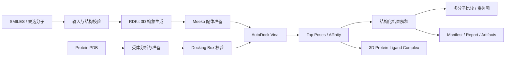
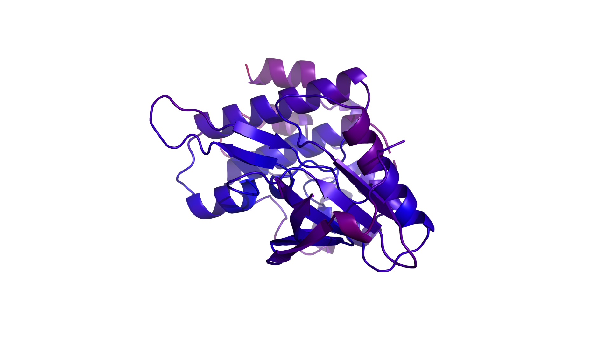
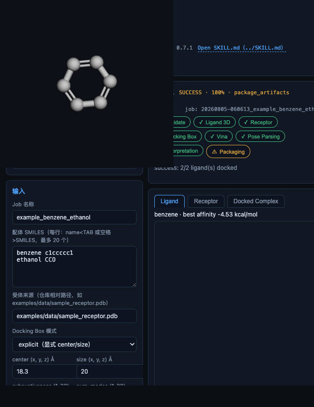
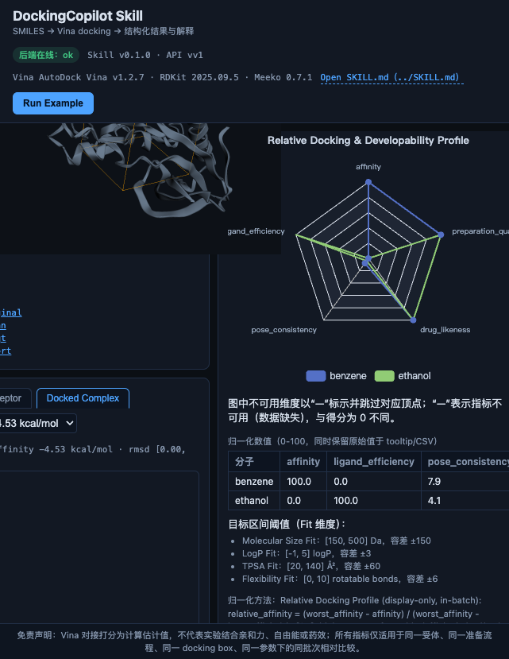

# DockingCopilot Skill

面向 **AI for Biomedicine** 赛道的分子对接 Copilot Skill：输入输出明确、
参数受控、过程可追踪、失败可诊断、结果可解释、运行可复现的
虚拟筛选 / 分子对接工作流。

> 可复现、可解释的分子对接科研工作流 Skill
> （A reproducible and interpretable molecular docking workflow skill）


> [!IMPORTANT]
> **GitHub 提交路径必须从仓库根目录直接开始：** `skills/docking-copilot/SKILL.md`。
> 不要上传成 `docking-copilot-skill/skills/docking-copilot/SKILL.md` 或其他多套一层目录的形式。
> `skills/` 下只保留一个目录 `docking-copilot/`，且该目录名必须与 `SKILL.md` frontmatter 中的 `name: docking-copilot` 完全一致。
> 上传 GitHub 后建议立即运行：`python skills/docking-copilot/scripts/validate_submission.py`。

核心交付物为 [`skills/docking-copilot/SKILL.md`](skills/docking-copilot/SKILL.md)（官方主 Skill 文档）；本仓库的代码、
schema、notebook、DAG、失败案例与示例是 Skill 的可验证附件。
提交摘要见 [`SUBMISSION.md`](SUBMISSION.md)。

## 功能概览

- 输入一个或多个 SMILES（≤20），自动完成 3D 构建（ETKDGv3 + MMFF94/UFF）
  与 PDBQT 准备（Meeko）；
- 受体分析（Biopython）与按策略清洗（链/水/辅因子/金属可配置）；
- 搜索盒四模式（explicit / reference_ligand / residue_list / whole_receptor）
  校验（边长 10–30 Å、体积 ≤27000 ų）；
- AutoDock Vina 对接（Python API 子进程优先、CLI 受控回退，固定 seed 可复现）；
- 结构化结果：affinity、top poses、ligand efficiency、描述符、警告、
  manifest 哈希与 bundle.zip；
- 13 个结构化失败案例（错误码/阶段/可恢复性/建议动作，全部有测试回归）；
- FastAPI（16 端点、串行队列、job.json 文件状态）+ React 前端 Demo
  （3Dmol.js 三维 + ECharts 雷达图）。

## 快速开始

```bash
# 1. 创建并激活环境（conda-forge，Python 3.11，macOS arm64）
mamba env create -f environment.yml
conda activate dockskill

# 2. 环境自检（成功输出 DOCKING_SKILL_CHECK_PASS）
make check

# 3. 运行示例：乙醇真实对接 + 非法 SMILES 结构化错误（输出 RUN_EXAMPLE_PASS）
make example

# 4. 运行测试（109 个用例）
make test

# 5. 可复现性双跑验证（输出 REPRODUCIBILITY_PASS）
make reproducibility
```

启动 API 与网页 Demo（两个终端）：

```bash
make backend    # FastAPI: http://127.0.0.1:8000 （仅本机监听）
make frontend   # Vite dev server: http://localhost:5173 （首次需 cd frontend && npm install）
```

## 目录结构

```text
skills/docking-copilot/SKILL.md  # 官方自动评审入口（主 Skill）
SUBMISSION.md       # 提交摘要（最短验证路径）
backend/            # app/（schemas + 9 services + workflow 状态机 + FastAPI）与 tests/（109 用例）
frontend/           # React + Vite + TypeScript + 3Dmol.js + ECharts（8 组件）
schemas/            # 4 个 JSON Schema（与 Pydantic 同源导出，make schemas）
dags/               # workflow.mmd / workflow.json / workflow.svg（make dag）
docs/               # 8 篇：WORKFLOW / PARAMETER_GUIDE / RESULT_INTERPRETATION /
                    # FAILURE_CASES / REPRODUCIBILITY / SCIENTIFIC_LIMITATIONS /
                    # SECURITY / ENVIRONMENT
examples/           # inputs/（3 个真实输入）+ failure_cases/（13 案例）+
                    # expected_outputs/ + data/（样例受体与来源说明）
notebooks/          # docking_skill_demo.ipynb + 已执行副本（.ipynb/.md）
scripts/            # check_environment / run_example / generate_schemas /
                    # generate_dag / generate_failure_cases /
                    # verify_reproducibility / pre_submission_check
reports/            # 环境自检、复现、测试、示例运行、质检等机器可读证据
outputs/            # 运行产物（gitignore，仅保留 .gitkeep）
```

## 常用命令

| 命令 | 说明 |
| --- | --- |
| `make check` | 环境自检（`scripts/check_environment.py`），成功标记 `DOCKING_SKILL_CHECK_PASS` |
| `make example` | 可复现示例（`scripts/run_example.py`），成功标记 `RUN_EXAMPLE_PASS` |
| `make test` | pytest（`backend/tests`，109 用例） |
| `make schemas` | 重新导出 `schemas/*.schema.json` |
| `make dag` | 重新生成 DAG 三件套 |
| `make failure-cases` | 再生成 13 个失败案例 |
| `make reproducibility` | 双跑可复现验证，成功标记 `REPRODUCIBILITY_PASS` |
| `make backend` / `make frontend` / `make dev` | API / 前端 / 开发提示 |
| `make clean` | 清理 Python 缓存（不删除 outputs/） |
| `conda run -n dockskill python scripts/pre_submission_check.py` | 提交前质检 |

## 资源约束（16GB 内存设备）

后端 `workers=1`、对接并发 1、批量分子上限 20、上传上限 20MB、
box 单边 10–30 Å、对接超时 300s，详见 `backend/app/config.py`。

## 科学边界

docking score 是经验打分，不是实验药效、不是精确结合自由能，只在
同受体/同准备/同 box/同参数下批内相对比较有意义。详见
`docs/SCIENTIFIC_LIMITATIONS.md` 与 `skills/docking-copilot/SKILL.md` 的科学边界章节。

## License

MIT，见 `LICENSE`；引用格式见 `CITATION.cff`。

---

## GitHub 项目展示

DockingCopilot Skill 面向 **AI4S Future ScienceSkills Hackathon — AI for Biomedicine / 生物医药科研软件 Copilot Skill**。项目将传统分散的分子对接步骤封装为一条可追踪科研工作流：从 SMILES 输入、小分子三维构象生成、蛋白受体准备和对接参数校验，到 AutoDock Vina 计算、Pose 解析、结果解释与多候选比较，均保留结构化输入输出与可复现产物。

### 端到端工作流



### 3D 结构与结果展示

<table>
<tr>
<td width="50%"></td>
<td width="50%"></td>
</tr>
<tr>
<td align="center"><b>蛋白 / 配体三维结构展示</b></td>
<td align="center"><b>对接工作流状态与中间产物展示</b></td>
</tr>
</table>

<p align="center">
  
</p>
<p align="center"><b>多候选分子的 Relative Docking & Developability Profile 雷达图比较</b></p>

### Skill 能力与赛题交付对应

| 赛题要求 | 本项目对应产物 |
| --- | --- |
| 完整、可复用的 Skill 文档 | `skills/docking-copilot/SKILL.md` |
| 配置与参数校验 | `backend/app/schemas.py`、`backend/app/services/box_service.py` |
| 脚本 / 工作流执行 | `backend/app/workflow/`、`scripts/run_example.py` |
| 可复现 Notebook | `notebooks/docking_skill_demo.ipynb` 与已执行副本 |
| 工作流 DAG | `dags/workflow.mmd` / `.json` / `.svg` |
| 输入 / 输出 Schema | `schemas/*.schema.json` |
| 结果解释 | `docs/RESULT_INTERPRETATION.md` |
| 失败案例 | `examples/failure_cases/`、`docs/FAILURE_CASES.md` |
| 科学边界与限制 | `docs/SCIENTIFIC_LIMITATIONS.md` |
| 可复现性证据 | `reports/reproducibility_report.json` |
| 辅助网页 Demo | `frontend/` + `backend/` |

### 网页 Demo 可展示内容

- 输入单个或多个 SMILES，并查看生成的分子 3D 构象；
- 查看蛋白受体 3D 结构、对接搜索区域及 protein–ligand complex；
- 切换不同候选分子与 Top Pose，查看对应 affinity 和结构化解释；
- 对同一受体、同一 box、同一参数下的多个候选分子进行批内比较；
- 通过雷达图同时查看 Relative Affinity、Ligand Efficiency、Pose Separation 与分子性质画像；
- 下载结构化 JSON、Markdown 报告和对接产物。

> **科学说明**：网页中的相对评分和雷达图用于同条件候选之间的辅助比较。AutoDock Vina affinity 属于经验打分结果，不等同于实验药效、Kd/Ki/IC50 或精确结合自由能。

### 自动评审快速入口

建议评审优先阅读或执行：

```text
skills/docking-copilot/SKILL.md
SUBMISSION.md
schemas/
dags/
notebooks/docking_skill_demo.executed.md
examples/failure_cases/
reports/submission_summary.json
```

最短本地验证：

```bash
make check
make example
make test
```


---

## 官方黑客松 Skill 入口（2026 提交格式）

自动评审入口为 [`skills/docking-copilot/SKILL.md`](skills/docking-copilot/SKILL.md)。该文件包含合法 YAML frontmatter，并将详细资料按渐进披露方式放在 [`skills/docking-copilot/references/`](skills/docking-copilot/references/)；根目录 `requirements.txt` 面向官方 Linux Docker 沙箱（2 核 / 4 GB / 无 GPU / 900 秒）。Mac mini M4 本地开发继续使用 `environment.yml`。

提交格式自检：

```bash
python skills/docking-copilot/scripts/validate_submission.py
```

官方沙箱依赖安装与核心运行时检查：

```bash
python -m pip install -r requirements.txt
python skills/docking-copilot/scripts/check_runtime.py
```
