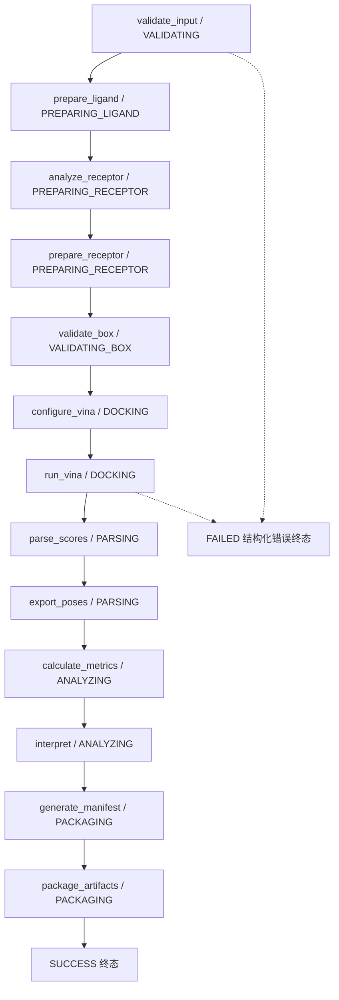

# 工作流（WORKFLOW）

DockingCopilot Skill 的一次对接任务是一条**线性、可审计的 DAG**：
任一环节失败即携带结构化错误进入 `FAILED` 终态，不会跳过步骤。

## 1. DAG 图

三件套产物（由 `make dag` 生成，见 `scripts/generate_dag.py`）：

- `dags/workflow.mmd` — Mermaid 源文件（节点标签含对应 JobState，失败路径为虚线边）
- `dags/workflow.json` — 机器可读的步骤/依赖/状态机定义
- `dags/workflow.svg` — 简化矢量图



## 2. 13 步说明

| # | 步骤 | 任务状态（JobState） | 职责 | 可能的错误码 |
| --- | --- | --- | --- | --- |
| 1 | `validate_input` | VALIDATING | Pydantic 校验 `DockingInput`（路径逃逸拒绝、批量上限、元素限制） | `INPUT_VALIDATION_FAILED`（含路径越界类 `ARTIFACT_ACCESS_DENIED` 案例） |
| 2 | `prepare_ligand` | PREPARING_LIGAND | SMILES → 3D 构象（ETKDGv3）→ MMFF94/UFF 优化 → 描述符 → Meeko PDBQT；批量时逐分子独立成败 | `INVALID_SMILES`、`MULTI_FRAGMENT_LIGAND`、`UNSUPPORTED_ELEMENT`、`LIGAND_TOO_LARGE`、`CONFORMER_GENERATION_FAILED`、`PDBQT_PREPARATION_FAILED` |
| 3 | `analyze_receptor` | PREPARING_RECEPTOR | 解析链、原子/残基计数、异源实体、包围盒 | `INVALID_RECEPTOR`、`FILE_NOT_FOUND` |
| 4 | `prepare_receptor` | PREPARING_RECEPTOR | 按 chain 过滤、去水/去异源、写清洗 PDB 与 PDBQT | `CHAIN_NOT_FOUND`、`RECEPTOR_PREPARATION_FAILED` |
| 5 | `validate_box` | VALIDATING_BOX | 四种模式（explicit/reference_ligand/residue_list/whole_receptor）→ center/size；边长 10–30 Å、体积 ≤ 27000 ų；box 必须覆盖受体包围盒 | `INVALID_BOX`、`BOX_TOO_LARGE`、`BOX_OUTSIDE_RECEPTOR` |
| 6 | `configure_vina` | DOCKING | 组装 Vina 配置（exhaustiveness、num_modes、energy_range、seed、cpu） | — |
| 7 | `run_vina` | DOCKING | 逐配体对接（优先 Python API 子进程隔离，崩溃受控回退 CLI；超时 300 s） | `VINA_FAILED`、`VINA_TIMEOUT` |
| 8 | `parse_scores` | PARSING | 解析 `REMARK VINA RESULT` → rank/affinity/rmsd | `NO_POSE` |
| 9 | `export_poses` | PARSING | 写 pose pdbqt 与转写 PDB | — |
| 10 | `calculate_metrics` | ANALYZING | 描述符、ligand efficiency、批次内比较指标（公式见 `RESULT_INTERPRETATION.md`） | — |
| 11 | `interpret` | ANALYZING | 生成 `result.md`（固定科学措辞 + 限制声明） | — |
| 12 | `generate_manifest` | PACKAGING | 写 manifest.json（输入/产物 sha256、版本、参数、命令记录） | — |
| 13 | `package_artifacts` | PACKAGING | 打包 bundle.zip | — |

## 3. 任务状态机（JobState，12 态）

```
CREATED → VALIDATING → PREPARING_LIGAND → PREPARING_RECEPTOR → VALIDATING_BOX
→ DOCKING → PARSING → ANALYZING → PACKAGING → SUCCESS
任一非终态 → FAILED（StructuredError）
任一非终态 → CANCELLED
```

- 合法转移表定义于 `backend/app/workflow/dag.py`（`TRANSITIONS`），
  非法转移直接抛错，防止状态跳变。
- 批量对接（≤20 配体）中单个配体失败**不终止整条 DAG**：
  该配体标记 FAILED 并写入 `structured_error`，其余配体照常对接，
  整体任务仍可 SUCCESS（见失败案例 `PARTIAL_BATCH_FAILURE`）。

## 4. 产物目录约定

```
outputs/<job_id>/
├── input.json                 # 规范化后的输入快照
├── manifest.json              # 哈希、版本、参数、命令记录（可复现核心）
├── job.json                   # 状态机轨迹
├── logs/                      # 逐步日志与 Vina 输出
├── ligands/<ligand_id>/       # 构象、描述符、2D 图、PDBQT、ligand_metadata.json
├── receptor/                  # 清洗 PDB、receptor.pdbqt、analysis.json
├── poses/<ligand_id>/         # pose_NNN.pdbqt / pose_NNN.pdb
├── reports/                   # result.json / result.md / comparison.csv
└── bundle.zip                 # 全量产物打包
```

## 5. 与代码的一致性保证

- `scripts/generate_dag.py` 从 `backend/app/workflow/dag.py` 的 `build_dag()` 生成三件套；
- `backend/tests/test_dag.py` 断言 DAG 节点序列与 runner 实际执行步骤、
  `TRANSITIONS` 状态机一致，且 `dags/` 三件套与源同步。

重新生成：`make dag`
