# E2E 验收截图说明

本文档记录 DockingCopilot Skill 端到端（E2E）验收过程中的关键截图。
截图文件与本文件同目录存放，通过 Markdown 相对路径引用。

## 验收流程截图

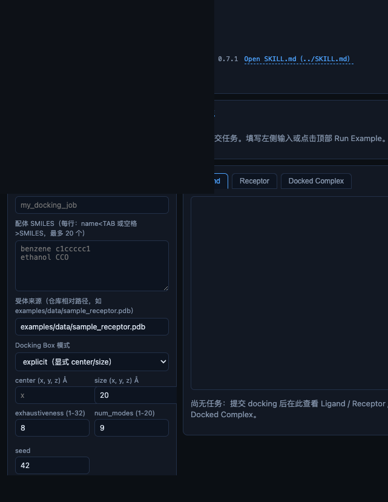

首页初始状态：展示任务配置入口、目标蛋白信息与运行状态面板，服务启动后页面正常加载。

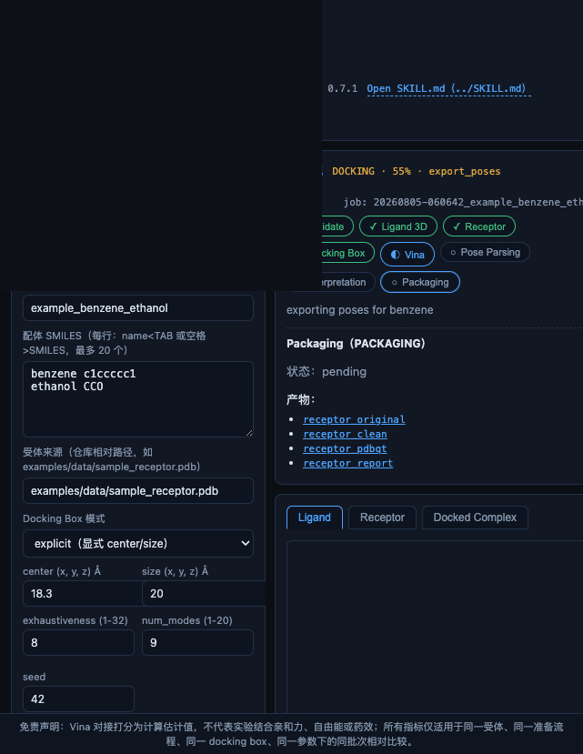

工作流运行中：提交对接任务后，前端实时显示流水线各阶段进度与运行状态。

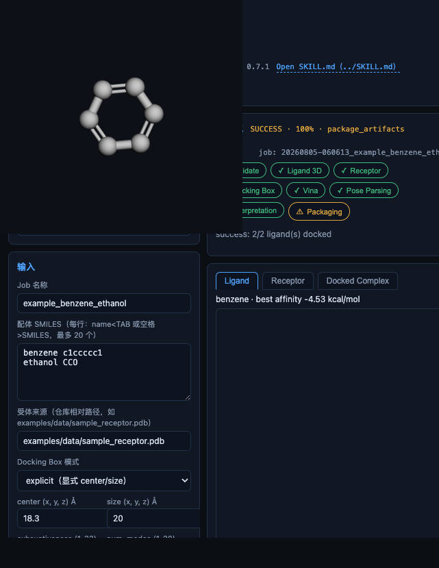

工作流 SUCCESS 全页截图：任务完成，整体状态为 SUCCESS，结果面板正常渲染。

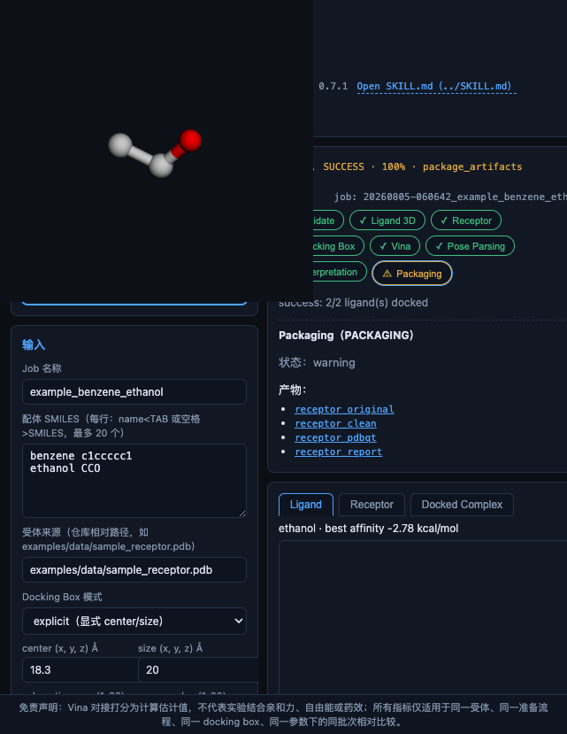

Ligand 3D 视图：结果页中配体小分子的 3D 可视化正常显示。

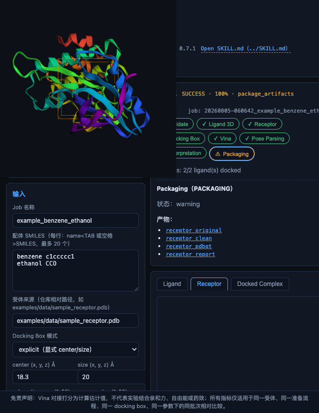

Receptor 3D 视图：受体蛋白结构的 3D 可视化正常显示。

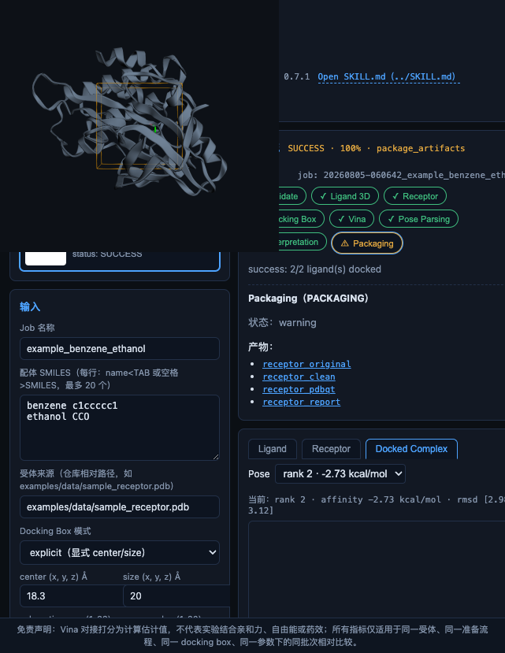

Complex 3D 视图：蛋白-配体复合物的 3D 可视化正常显示，对接构象与口袋结合关系可见。

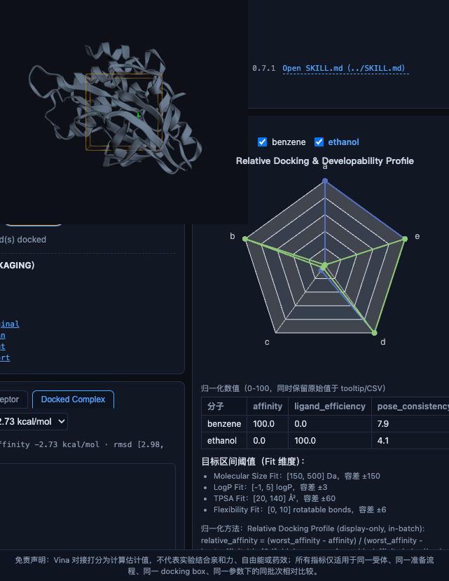

> **注：历史缺陷记录。** 本图为修复前手动注入演示数据截取的雷达图为空的缺陷现场，用于记录该 bug 的复现状态，不代表修复后行为。

雷达图区域为空：评估指标雷达图未渲染数据（修复前的缺陷现象）。

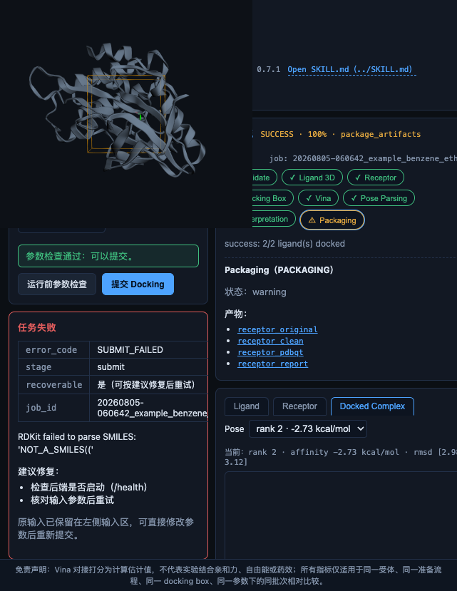

失败面板：任务失败时前端展示错误信息与失败详情面板，便于用户诊断问题。

## 缺陷修复后复验截图

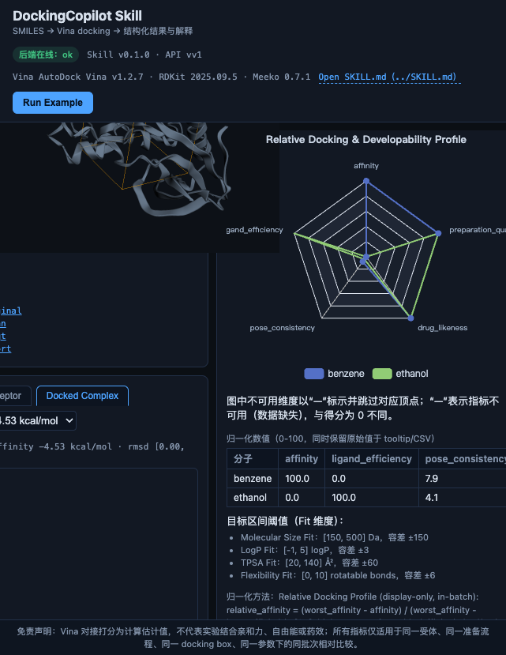

雷达图修复后复验：完整评估指标雷达图正常渲染，数据点与维度标签齐全。

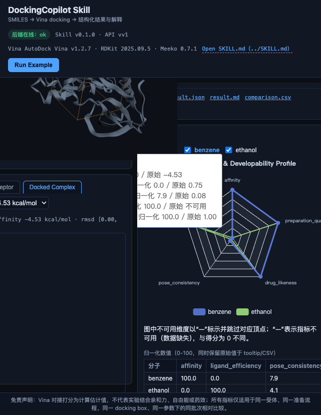

雷达图 SUCCESS 场景 tooltip 复验：鼠标悬停交互正常，数值提示正确显示。

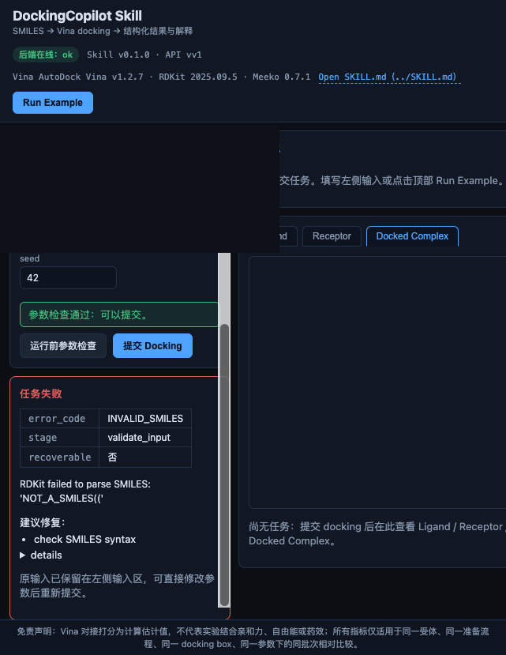

失败面板修复后复验：输入非法 SMILES 时，失败面板正确展示错误原因，不再出现渲染异常。
