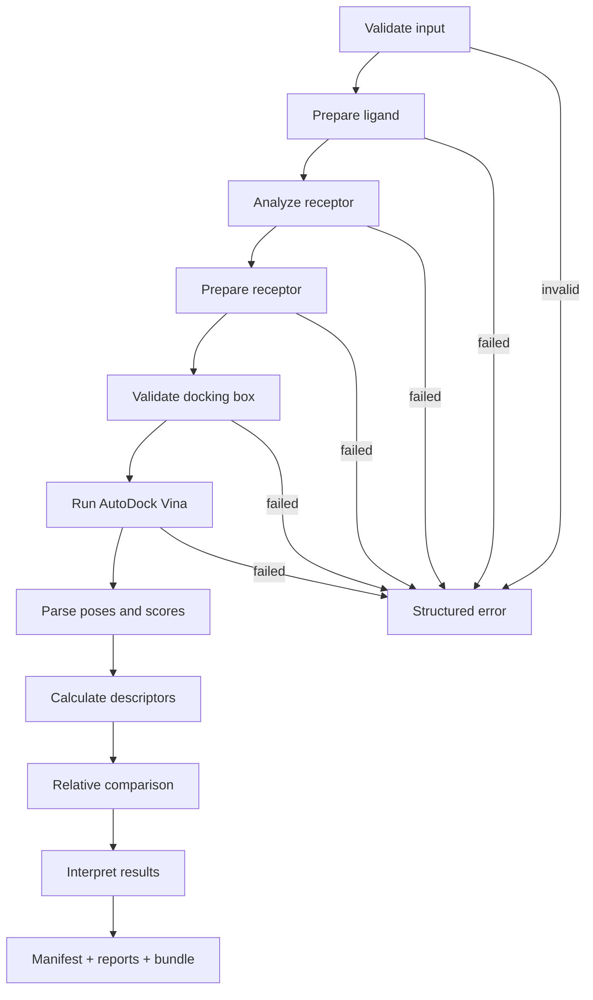

# DockingCopilot

DockingCopilot 将 **SMILES + 蛋白受体 + docking 配置** 转换为受校验、可复现的 AutoDock Vina 工作流，并输出结构化结果、pose、中间产物、运行记录与科学解释。它适合科研原型、小规模候选比较和对接配置检查，不把 docking score 当作真实药效或精确结合自由能。

## 1. 何时使用

在以下请求中使用本 Skill：

- 从一个或多个 SMILES 构建 3D 配体并进行蛋白-小分子 docking；
- 检查 receptor、链选择、docking box 或 Vina 参数是否合理；
- 运行单分子或小批量虚拟筛选，并输出可复现产物；
- 比较同一受体、同一 box、同一参数下多个候选分子的 affinity / ligand efficiency / pose；
- 解释 docking 结果、生成结构化报告、诊断失败并给出恢复建议；
- 需要 Notebook、DAG、Schema、manifest、失败案例等可复现科研软件产物。

不要用于：临床决策、直接预测药效、把 Vina affinity 换算为 Kd/Ki/IC50、要求柔性受体/高精度自由能但未使用相应方法、复杂共价/金属体系且未专门参数化。

## 2. 官方沙箱约束

正式评测环境按主办方规范处理：**Linux Docker、2 CPU、4 GB RAM、无 GPU、单任务 900 秒**。根目录 `requirements.txt` 是官方沙箱依赖入口；`environment.yml` 仅用于 Mac mini M4 本地开发。

执行正式任务时：

- 优先 CPU；不要尝试 CUDA/GPU；
- 建议显式设置 `docking_parameters.cpu=2`；
- 小批量执行，避免一次处理大量分子；
- 默认 `exhaustiveness=8`、`num_modes=9`；只有任务需要时再提高；
- 不依赖私有 API、私有凭据或非白名单网络；
- 任何失败都返回结构化错误，禁止静默伪造结果。

依赖和沙箱说明：`references/OFFICIAL_SANDBOX.md`。

## 3. 输入

权威模型：`backend/app/schemas.py`；机器可读 Schema：`schemas/docking_input.schema.json`。

最小输入包含：

1. `ligands`：一个或多个 `{id, name, smiles}`；
2. `receptor`：仓库内/任务工作区 PDB 路径及受体处理配置；
3. `docking_box`：明确的搜索空间；
4. `docking_parameters`：Vina scoring、exhaustiveness、num_modes、energy_range、cpu、seed。

典型结构：

```json
{
  "ligands": [{"id": "ligand_001", "name": "candidate_A", "smiles": "CCO"}],
  "receptor": {
    "file": "examples/data/sample_receptor.pdb",
    "config": {"selected_chains": ["A"], "remove_original_ligands": true}
  },
  "docking_box": {
    "mode": "explicit",
    "center": [0.0, 0.0, 0.0],
    "size": [20.0, 20.0, 20.0]
  },
  "docking_parameters": {
    "scoring_function": "vina",
    "exhaustiveness": 8,
    "num_modes": 9,
    "energy_range": 3.0,
    "cpu": 2,
    "seed": 42
  }
}
```

实际字段、默认值、单位、范围和四种 box 模式见 `references/INPUT_OUTPUT_SCHEMA.md`。

## 4. 输出

权威输出模型同样位于 `backend/app/schemas.py`；Schema：

- `schemas/docking_output.schema.json`
- `schemas/comparison_output.schema.json`
- `schemas/error.schema.json`

成功结果至少包含：

- 每个 ligand 的 `status`；
- `best_affinity_kcal_mol`；
- top poses（rank、affinity、RMSD、pose 文件）；
- RDKit descriptors；
- ligand efficiency；
- warnings；
- 科学解释；
- comparison context / 批次内相对指标；
- provenance 与 artifact 路径。

失败结果返回 `error_code`、`stage`、`message`、`recoverable` 和 `suggested_actions`。详细字段见 `references/INPUT_OUTPUT_SCHEMA.md`。

## 5. 工作流



代码执行器：`backend/app/workflow/runner.py`。详细 DAG、状态机和执行规则见 `references/WORKFLOW_EXECUTION.md`。

## 6. 执行策略

面对实际任务，按此顺序：

1. **读取任务输入**，确认 SMILES、PDB、目标链、box 来源和输出目标；
2. **先校验再运行**，不要自动假设缺失的结合位点；
3. **准备配体**：RDKit sanitize → 加氢 → ETKDGv3 3D → MMFF，必要时按既定规则回退 UFF → Meeko PDBQT；
4. **分析受体**：识别链、模型、异源原子、水、金属、辅因子、原配体与结构缺陷；
5. **准备受体**：保留原始输入，按配置清洗并生成 receptor PDBQT；
6. **校验 box**：中心/尺寸/体积/与受体包围盒关系必须合法；
7. **运行 Vina**：官方沙箱建议 CPU=2，固定 seed 以提高可复现性；
8. **解析结果**：保存 top poses 与 affinity，不只返回单个分数；
9. **解释**：同时报告参数、warnings、科学限制与可比较条件；
10. **打包证据**：生成 manifest、JSON、Markdown、CSV、结构文件和 bundle。

决策和回退规则见 `references/WORKFLOW_EXECUTION.md` 与 `references/PARAMETER_GUIDE.md`。

## 7. 关键校验规则

### 配体

- SMILES 必须能被 RDKit 解析和 sanitize；
- 多片段、异常价态、不支持元素、过大分子必须警告或拒绝；
- 3D 构象生成必须记录 seed；
- MMFF 不可用时仅按既定规则回退 UFF，并记录 warning；
- PDBQT 生成失败不得继续 docking。

### 受体

- PDB 必须存在有效蛋白原子；
- 指定链必须存在；
- 多模型、缺失残基、非标准残基、水、金属、辅因子和原配体必须显式处理或警告；
- 保留原始 PDB 和 receptor preparation report。

### Docking box

- center 必须为 3 个有限数；
- size 必须为正，且满足代码中的边长/体积限制；
- box 不应完全位于受体之外；
- 未提供可靠口袋信息时，不要静默猜测“最佳结合位点”。

### Vina

- 参数必须通过 Pydantic/服务层校验；
- 禁止把用户输入拼接到 `shell=True`；
- 失败、超时、无 pose 均返回结构化错误；
- 同批比较必须使用一致 receptor、preparation、box 和 Vina 参数。

## 8. 结果解释规则

必须使用科学保守措辞：

- Vina affinity 单位为 kcal/mol；在同一设置下更负通常表示评分函数认为该 pose 更有利；
- affinity **不是**实验结合自由能，也不能直接换算为 Kd、Ki、IC50 或药效；
- ligand efficiency 是按重原子数归一化的辅助指标，不代表真实活性；
- top pose 与次优 pose 的分数接近时，提示构象选择不确定性；
- “Relative Docking Profile / 相对对接与分子性质画像”只用于同批次展示；
- 雷达图和综合展示分必须同时保留原始指标与计算公式，不能作为实验结论。

完整解释、归一化公式和示例见 `references/RESULT_INTERPRETATION.md` 与 `references/INTERPRETATION_FAILURES.md`。

## 9. 失败与恢复

常见结构化失败包括：

`INVALID_SMILES`、`MULTI_FRAGMENT_LIGAND`、`UNSUPPORTED_ELEMENT`、`LIGAND_TOO_LARGE`、`CONFORMER_GENERATION_FAILED`、`PDBQT_PREPARATION_FAILED`、`INVALID_RECEPTOR`、`CHAIN_NOT_FOUND`、`RECEPTOR_PREPARATION_FAILED`、`INVALID_BOX`、`BOX_OUTSIDE_RECEPTOR`、`BOX_TOO_LARGE`、`VINA_FAILED`、`VINA_TIMEOUT`、`NO_POSE`。

处理原则：

1. 明确失败阶段；
2. 返回可恢复性；
3. 给出具体修复动作；
4. 保留日志和已生成产物；
5. 批量任务允许部分失败，但失败分子不得进入虚假排名。

完整失败案例与测试映射见 `references/FAILURE_CASES.md` 和 `references/INTERPRETATION_FAILURES.md`。

## 10. 可复现性与证据链

每次运行应记录：

- 输入文件和 SHA256；
- receptor / ligand / artifact hash；
- RDKit、Meeko、Vina、Python 版本；
- docking 参数与 random seed；
- 开始/结束时间和运行状态；
- warnings / errors；
- 产物路径。

产物默认位于 `outputs/<job_id>/`，包括该任务目录中的 input、manifest、job 状态、ligand/receptor/pose 文件、结构化 JSON、Markdown 报告、comparison CSV 和 bundle ZIP。

详细说明见 `references/REPRODUCIBILITY.md` 与 `references/REPRODUCIBILITY_ARTIFACTS.md`。

## 11. 最短验证路径

从仓库根目录执行。

### 官方 Linux 沙箱依赖

```bash
python -m pip install -r requirements.txt
python skills/docking-copilot/scripts/check_runtime.py
```

成功标记：`DOCKING_SKILL_RUNTIME_PASS`。

### 运行真实示例

```bash
python skills/docking-copilot/scripts/run_example.py
```

它调用现有 `scripts/run_example.py`，执行真实单分子 Vina docking，并验证非法 SMILES 的结构化失败。成功标记：`RUN_EXAMPLE_PASS`。

### Schema 与测试

```bash
python scripts/generate_schemas.py
pytest -q backend/tests
```

网页前端是辅助演示，不是官方科学任务执行依赖。

## 12. Notebook、DAG 与辅助 Demo

- 可复现 Notebook：`notebooks/docking_skill_demo.ipynb`；
- 已执行 Notebook：`notebooks/docking_skill_demo.executed.ipynb`；
- DAG：`dags/workflow.mmd`、`dags/workflow.svg`、`dags/workflow.json`；
- Web Demo：React + 3Dmol.js + ECharts，可展示 ligand、receptor、docked complex、pose 和多分子雷达图；
- Demo 不能替代 JSON/Markdown/Schema 证据。

详细参考：`references/REPRODUCIBILITY_ARTIFACTS.md`。

## 13. 安全与科学边界

- 本地/沙箱文件路径必须受工作目录约束，防止 path traversal；
- 不使用 `shell=True` 拼接用户输入；
- 限制上传文件、批量分子数和 docking box；
- 不依赖私有凭据；
- 不把失败伪装为成功；
- 不把 docking 分数包装成临床或实验结论；
- 静态/刚性 receptor、质子化/互变异构、水/辅因子、box 选择和 scoring function 都是主要不确定性来源；
- 复杂体系应升级到人工检查、MD/FEP 或实验验证。

详见 `references/SCIENTIFIC_LIMITATIONS.md`、`references/SECURITY.md`、`references/SCIENTIFIC_SECURITY_EVIDENCE.md`。

## 14. 自动评审应优先检查的证据

1. `skills/docking-copilot/SKILL.md`：官方 Skill 入口；
2. `requirements.txt`：Linux 沙箱额外依赖；
3. `backend/app/schemas.py` + `schemas/*.json`：I/O 契约；
4. `backend/app/workflow/runner.py`：真实工作流；
5. `notebooks/docking_skill_demo.executed.ipynb`：可复现演示；
6. `examples/failure_cases/` + `backend/tests/test_failures.py`：失败案例；
7. `reports/test_report.json`、`reports/reproducibility_report.json`：测试与复现证据；
8. `references/`：渐进披露的详细科学与工程说明。

## 15. 引用

核心第三方工具：RDKit、AutoDock Vina、Meeko、Biopython、Open Babel；辅助网页使用 3Dmol.js 和 ECharts。许可证和正式引用信息见根目录 `CITATION.cff`、`LICENSE` 与 `references/SCIENTIFIC_SECURITY_EVIDENCE.md`。
