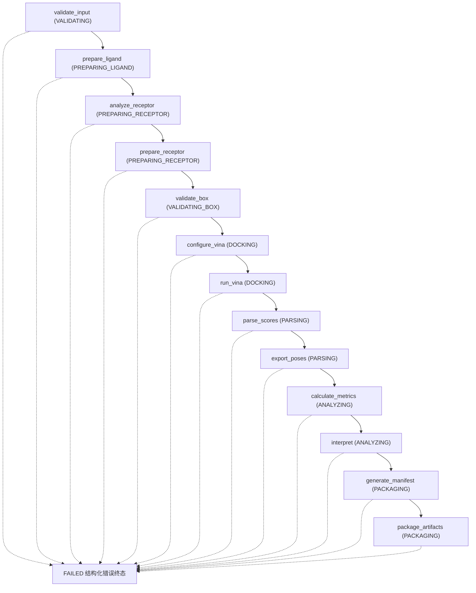

# 工作流、执行步骤与参数决策详细参考

## 8. Workflow DAG

与 `dags/workflow.mmd` 逐行一致（`make dag` 由
`backend/app/workflow/dag.py` 的 `build_dag()` 生成三件套；
`backend/tests/test_dag.py` 断言其与 runner 实际执行步骤一致）：



配套产物：`dags/workflow.svg`（矢量图）、`dags/workflow.json`（机器可读
节点/边/状态）、`docs/WORKFLOW.md`（13 步逐步说明与 12 态状态机）。

## 9. Execution Procedure

所有命令在项目根目录执行。Python 统一使用 conda 环境 `dockskill`
（未激活时 Makefile 自动使用 `conda run -n dockskill python`）。

```bash
# 0. 创建环境（一次性）
mamba env create -f environment.yml
conda activate dockskill

# 1. 环境检查（预期输出唯一标记 DOCKING_SKILL_CHECK_PASS，退出码 0）
make check

# 2. 运行仓库示例：乙醇真实对接 + 非法 SMILES 结构化错误
#    （预期输出 RUN_EXAMPLE_PASS，退出码 0）
make example

# 3. 启动 API 服务（默认仅监听 127.0.0.1:8000）
make backend
# 健康检查：
curl -s http://127.0.0.1:8000/health

# 4. Notebook（已执行的副本可直接阅读；重新执行命令如下）
conda run -n dockskill jupyter nbconvert --to notebook --execute \
  notebooks/docking_skill_demo.ipynb \
  --output docking_skill_demo.executed.ipynb

# 5. 前端 Demo（另开一个终端；http://localhost:5173）
make backend      # 终端 1
make frontend     # 终端 2（首次需 cd frontend && npm install）

# 5b. 一键打开网页 Demo（幂等）：服务未启动则自动后台启动，随后自动打开浏览器
make web

# 6. 测试（109 个用例）
make test

# 7. 可复现检查（预期输出 REPRODUCIBILITY_PASS）
make reproducibility
```

无 `make` 时的等价命令：

```bash
conda run -n dockskill python scripts/check_environment.py
conda run -n dockskill python scripts/run_example.py
PYTHONPATH=backend conda run -n dockskill python -m pytest backend/tests
conda run -n dockskill python scripts/verify_reproducibility.py
bash scripts/open_demo.sh
```

### 9.1 对话交互要求（网页入口前置）

执行本 Skill 的对话必须让用户随时能一键进入网页界面：

1. **对话开始时的第一条回复开头**必须输出可点击的网页链接（Markdown 格式）：
   `[DockingCopilot 网页 Demo](http://localhost:5173)`；
2. **启动服务或完成对接任务后，必须自动打开网页界面**：执行 `make web`
   （幂等：服务已在运行时只打开浏览器，绝不重启或打断现有服务），
   让用户直接看到结果界面；
3. 无 GUI / headless 环境下浏览器打开失败时，脚本与回复退化为仅输出上述
   Markdown 链接，不中断流程。

## 10. Parameter Validation Rules

实现：`backend/app/schemas.py`（Pydantic）+ `backend/app/config.py`（上限常量）
+ `backend/app/utils/files.py`（路径沙箱）。

| 维度 | 规则 |
| --- | --- |
| SMILES | 结构校验（Pydantic 长度 1–500）在输入阶段；化学合法性在 `prepare_ligand` 阶段由 RDKit 判定，非法报 `INVALID_SMILES`；多片段报 `MULTI_FRAGMENT_LIGAND` |
| 元素 | 配体仅允许 H,B,C,N,O,F,Si,P,S,Cl,Br,I（Vina 原子类型表），否则 `UNSUPPORTED_ELEMENT` |
| PDB | 受体必须非空且含 ATOM 记录，否则 `INVALID_RECEPTOR`；大小 ≤ 20 MB（`UPLOAD_MAX_MB`） |
| 链 | `selected_chains` 中不存在的链报 `CHAIN_NOT_FOUND`（details 列出可用链） |
| box | explicit 必须同时给 center/size；单边 10–30 Å；体积 ≤ 27000 ų；必须与受体包围盒相交；reference/residue 模式的残基必须存在（否则 `INVALID_BOX`，不静默生成盒） |
| Vina | exhaustiveness 1–32；num_modes 1–20；energy_range 0–10；cpu 1–8；单配体超时 300 s（`VINA_TIMEOUT`） |
| 文件 | 所有用户路径经 `safe_resolve` 限制在项目根内，`../` 穿越与符号链接逃逸拒绝（`PathTraversalError` → `INPUT_VALIDATION_FAILED`，案例 `ARTIFACT_ACCESS_DENIED`） |
| 批量 | 配体数 ≤ 20（`BATCH_MAX_LIGANDS`）；`ligand_id` 批内唯一 |
| 内存 | workers=1、对接并发 1、Vina cpu ≤ 8（16GB 设备约束，`config.py`） |
| 安全 | 无 shell 字符串插值（Vina CLI 用参数列表）；API 错误统一 StructuredError 形状，不泄漏堆栈（`backend/app/main.py` 全局异常处理器） |

API 请求体校验失败统一返回 400 + `INPUT_VALIDATION_FAILED`
（`schemas/error.schema.json` 形状）。

## 11. Decision and Fallback Rules

所有回退都是**受控且留痕**的：写入 `warnings` / `preparation_warnings` /
`provenance`，绝不静默修复、绝不吞错。

| 场景 | 决策 | 实现/证据 |
| --- | --- | --- |
| MMFF94 参数不可用 | 受控回退 UFF，记录 preparation warning，`provenance.force_field_used` 如实标注 | `backend/app/services/ligand_service.py` |
| Meeko 严格模式失败 | 受控回退 `mk_prepare_receptor --allow_bad_res`（删除无法匹配模板的残基）并记录任务级 warning；两次均失败报 `RECEPTOR_PREPARATION_FAILED` | `backend/app/services/receptor_service.py`；示例受体实测触发该回退，删除 18 个未匹配模板的残基（257→239），warning 见任意示例运行 `outputs/<job_id>/reports/result.json` |
| reference ligand 缺失 | **不得静默生成 box**：`reference_ligand_resid` 未找到报 `INVALID_BOX`（错误信息含 "not found"），任务进入 FAILED | `backend/app/services/box_service.py` |
| docking 无 pose | 输出无 `REMARK VINA RESULT` 时报 `NO_POSE`（可恢复），不返回空列表冒充成功 | `backend/app/workflow/runner.py`；失败案例 `examples/failure_cases/NO_POSE/`（mock 触发，已在其 expected.json notes 说明） |
| 批量部分失败 | 单分子失败不终止整批：该分子 `status=FAILED` 且写入其 `structured_error`，其余照常对接，任务整体仍可 SUCCESS | 失败案例 `examples/failure_cases/PARTIAL_BATCH_FAILURE/` |
| Vina Python API 失败/崩溃 | API 在独立子进程运行（C++ 层 SIGABRT 只杀子进程），受控回退 CLI；两者均失败报 `VINA_FAILED`，双适配器错误都保留在 details | `backend/app/services/vina_service.py`；失败案例 `examples/failure_cases/VINA_FAILED/` |
| 警告 vs 失败的边界 | 可继续且不影响结果结构的问题（缺失残基、altloc 去除、力场回退）→ warning；无法产出合法结果（解析失败、无 pose、PDBQT 损坏）→ 结构化错误终态 | `docs/FAILURE_CASES.md` §说明 2 |
